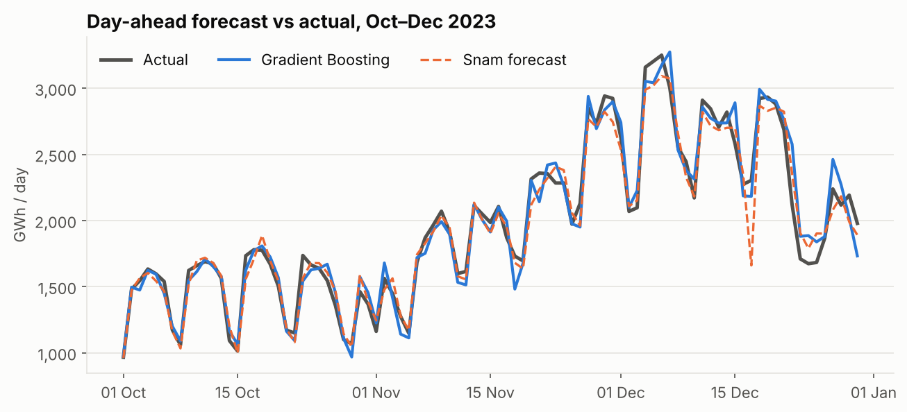
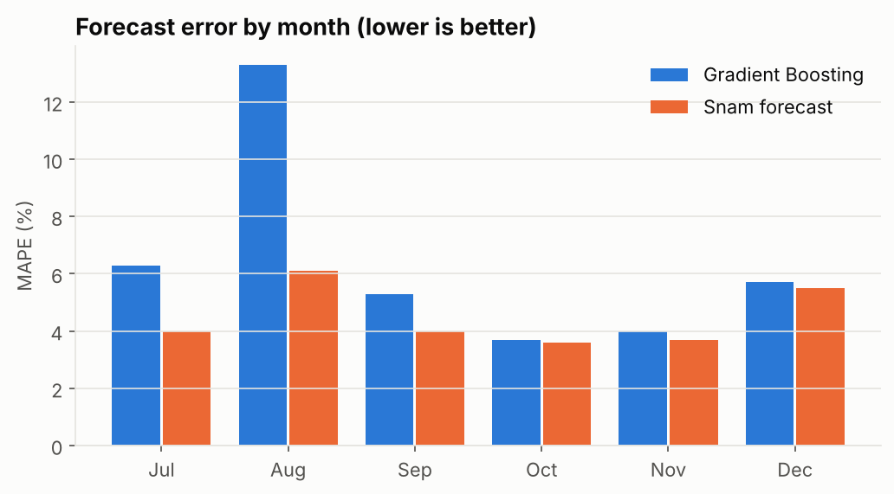
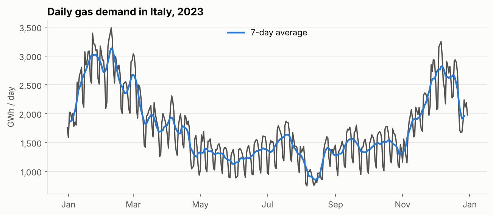
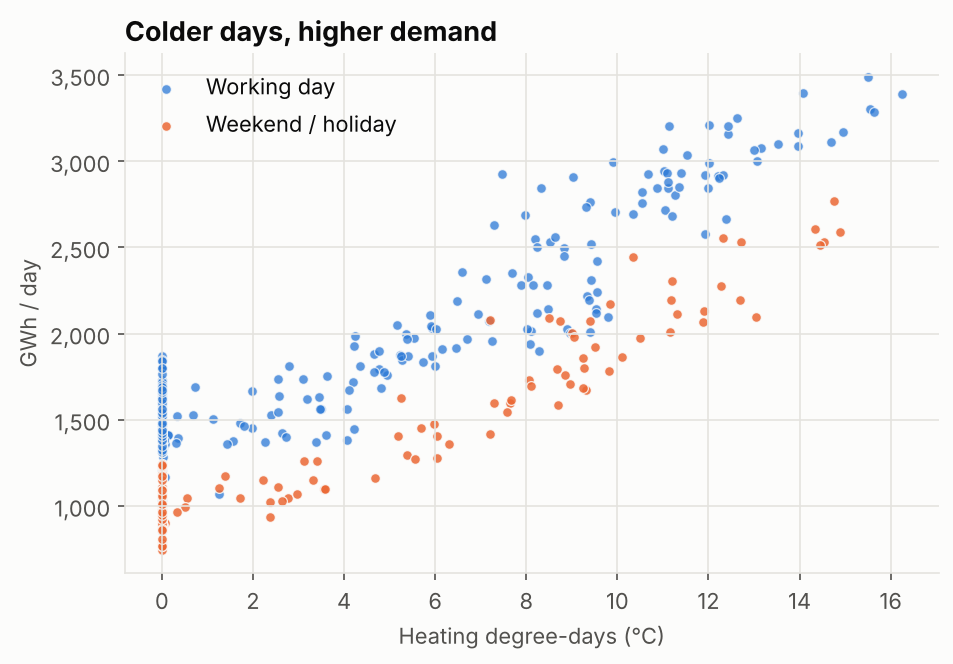

# Day-ahead Forecasting of Italian Gas Demand

Forecasting tomorrow's total gas demand on the Italian transmission network using **only public data** from Snam, and benchmarking the result against **Snam's own operational forecast**.

## Key results

Walk-forward backtest, 1 Jul – 30 Dec 2023 (183 days), models re-trained weekly on past data only.

| Model | MAE (GWh/day) | MAPE | R² |
|---|---|---|---|
| Snam forecast *(benchmark)* | 72 | 4.5% | 0.97 |
| **Gradient Boosting** | **93** | **6.4%** | **0.95** |
| Random Forest | 93 | 6.1% | 0.96 |
| Linear Regression | 118 | 7.4% | 0.92 |
| Seasonal naive (same day last week) | 212 | 13.3% | 0.74 |

- **−56% MAE** vs the seasonal naive baseline
- In the **heating season (Oct–Dec)** the model is on par with Snam's forecast: MAPE 4.5% vs 4.2%, R² 0.960 vs 0.959
- Snam's forecast is the operational reference of the network operator, so getting this close with a simple public-data model is a meaningful result

The gap is largest in **August**: the industrial summer shutdown appears only once in a single year of data, so the model cannot learn it from history.

## Problem setup

- **Target:** `RICONSEGNATO`, total gas delivered by the national network per gas day (06:00–06:00), in MWh
- **Issue time:** 12:00 on day *D*, forecasting day *D+1*
- **No look-ahead:** every feature is built from what Snam had published by 12:00 on day *D*

| Feature | Description |
|---|---|
| `demand_today_at_issue` | Snam's intraday estimate of today's demand |
| `hdd_forecast`, `delta_hdd` | Forecast heating degree-days for tomorrow and change vs today |
| `delta_lag_7` | Day-over-day change one week earlier |
| Calendar | Day of week, weekends/holidays and transitions, bridges, August and Christmas breaks |

**Key design choice:** the models predict the **change** from today's estimate to tomorrow's demand, not the level. Tree-based models cannot extrapolate the strong seasonal trend, but they learn day-to-day changes well.

## Exploratory analysis

| Seasonality | Temperature and calendar |
|---|---|
|  |  |

Demand correlates at 0.86 with heating degree-days, and working days sit clearly above weekends and holidays at the same temperature.

## Data

Snam Rete Gas, **Dati Operativi 2023**: hourly publications of the gas balance of the Italian network (public, downloadable from snam.it).

| Sheet | Used for |
|---|---|
| `Storico_G-1` | Settled demand of the previous day (actuals) |
| `Storico_G` | Intraday estimate of the current day |
| `Storico_G+1` | Snam's forecast for the next day and forecast HDD |

`src/data.py` turns 8,768 hourly publications into a clean daily table (365 gas days), handling the gas-day convention and re-published hours.

## Repository structure
